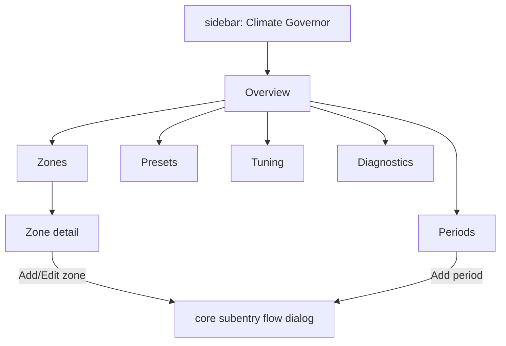

# Climate Governor — dedicated configuration panel (Tier C)

Design for an Energy-panel-like surface: one sidebar entry, internal navigation,
aggregate/modify/explore the whole system. Written against **HA 2026.10.4** and
the official docs at <https://contributors.home-assistant.io/>.

Status: **design only — no code written yet.** Decisions to confirm are at the end.

---

## 0. What already exists (do not rebuild)

The backend model is correct and stays exactly as is:

- one config entry (the plant) + `single_config_entry: true`
- `zone` and `period` **config subentries** with their own flows
- per-zone device (`identifiers={(DOMAIN, subentry_id)}`) + entity set
- options flow (presets / season / control defaults), repairs, diagnostics

The panel is a **presentation layer over that model**, not a replacement for it.
Anything else would mean re-implementing validation, migration, and registry
linkage for zero UX gain.

Already shipped in this pass (verified, 74 tests green):

| change | effect |
| --- | --- |
| `integration_type: helper` → `hub` | entry leaves the flat Helpers list, renders a real integration card |
| `categories: ["climate.thermostats_heating"]` | findable under Climate |
| `GovernorCoordinator.async_sync_areas()` | zone devices get the area chosen in the zone subentry |
| `initiate_flow.reconfigure` labels | explicit "Edit zone" / "Edit schedule period" |

---

## 1. Why a panel is possible, and what it costs

Verified mechanism (precedent: `homeassistant/components/dynalite/panel.py`):

```python
from homeassistant.components import panel_custom
from homeassistant.components.http import StaticPathConfig

await hass.http.async_register_static_paths(
    [StaticPathConfig("/climate_governor_static", dist_dir, cache_headers=False)]
)
await panel_custom.async_register_panel(
    hass=hass,
    frontend_url_path="climate-governor",
    config_panel_domain=DOMAIN,          # core's "Configure" now points here
    webcomponent_name="climate-governor-panel",
    module_url=f"/climate_governor_static/entrypoint-{build_id}.js",
    require_admin=True,
)
```

`config_panel_domain=DOMAIN` is the key: the frontend resolves the integration's
Configure link to our panel instead of core's generic screen —
`Object.values(panels).find(p => p.config_panel_domain === domain)?.url_path`.
That is what makes it feel like *one coherent system* rather than scattered helpers.

The panel element receives `hass`, `narrow`, `route` (`{prefix, path}` → internal
navigation), and `panel`. It owns its whole page, including header and sidebar
toggle on narrow screens.

### The honest cost

Docs are explicit: *"The frontend has no public component library… For anything
else, like a picker or a form field, build or bundle your own."* `ha-*` elements
are lazy chunks, unsupported, and can change in any release. There is **no import
map** in the shipped `index.html`, so Lit is not shared.

So the panel must:

1. bundle its own Lit (or none), and
2. provide its own entity/area/floor pickers, **or** delegate form steps to core's
   flow API (recommended — see §3).

Budget: this is a multi-day project, not an afternoon. Phase 1 below is the
minimum that already feels coherent.

---

## 2. Information architecture

Mirror the mental model: **plant → zones → periods**, with live state beside
configuration.

```
/climate-governor                     overview
├── /zones                            zone list (cards: state, duty cycle, area)
│   ├── /zone/<subentry_id>           one zone: live + config + diagnostics
├── /periods                          schedule table (week grid)
├── /presets                          preset setpoints (heat/cool matrix)
├── /tuning                           season, gains, master switches
└── /diagnostics                      coordinator state, repairs, actuator caps
```

Sidebar: one item, `mdi:thermostat`, label from the entry title.



---

## 3. Reads and writes

### Reads — no new backend needed

Everything the overview needs is already in the state machine:

- `climate.<zone>` — hvac action, preset, target
- `sensor.<zone>_duty_cycle`, `_control_output`, `_integral`,
  `_next_schedule_change`, `_actuator_capabilities`
- `binary_sensor.<zone>_actuator_active`, `_blocked`, `_in_comfort_band`
- `select.<entry>_season`, `switch.<entry>_master_heating|cooling`
- `hass.panels`, `hass.config_entries`, `hass.devices`, `hass.areas`

Entity ids derive from the zone slug, so the panel should **not** guess them:
read `hass.entities`/`hass.devices` and map device → subentry → entities.

### Writes — reuse core flows, do not invent a parallel API

| action | API |
| --- | --- |
| add / edit zone or period | REST flow: `POST /api/config/config_entries/subentries/flow` with `handler: [entry_id, "zone"]`, then `POST /api/config/config_entries/subentries/flow/{flow_id}` |
| delete subentry | WS `config_entries/subentries/delete` |
| list subentries | WS `config_entries/subentries/list` |
| options (presets, season) | core options flow (`/api/config/config_entries/options/flow`) |
| CONFIG-category entities | normal `number.set_value` / `switch.turn_on` / `select.select_option` |

Reusing the flows is the single most important decision here: it keeps one
source of truth for validation, keeps `strings.json` labels working, and means
the panel never drifts from what the config flow accepts. Rendering our own
forms would fork that logic permanently.

Two options for the flow UI:

- **A. Delegate (recommended, cheap):** open core's flow dialog / navigate to
  `/config/helpers/add?...` style routes, or embed the flow steps returned by the
  REST API in a dialog we render. Zero duplicated validation.
- **B. Native forms:** reimplement each step's fields in the panel. Nicer feel,
  but duplicates every selector and will drift. Only worth it for the tuning
  page, where fields are few and numeric.

---

## 4. Backend additions required

New `custom_components/climate_governor/panel.py`:

- `async_setup_panel(hass, entry)` — register static path + panel, once per
  install (guard on `hass.data`), remove on unload.
- `manifest.json` gains: `"dependencies": ["http", "websocket_api"]`,
  `"after_dependencies": ["panel_custom", "weather", "person"]`.
  (dynalite uses exactly this shape.)
- Optional small WS command `climate_governor/overview` returning the plant
  summary in one round-trip (entry + subentries + per-zone live values). Worth it
  to avoid the panel stitching 6 subscriptions together; not strictly required.

Static assets: `custom_components/climate_governor/frontend/dist/` served at
`/climate_governor_static`, build-id in the filename for cache busting
(`entrypoint-<build_id>.js`), same as dynalite.

---

## 5. Frontend build

- TypeScript + Lit + esbuild (or Vite lib mode), output one ESM bundle.
- Bundle Lit (~25 kB gz) — no shared copy available.
- Commit `dist/` to the repo so installing the integration needs **no** toolchain
  (matches your "build step is fine, but keep install simple" preference).
- Dev loop: `npm run dev` watches and writes to `frontend/dist/`, then reload the
  panel; HA restart not needed for JS changes.
- Theme: use CSS custom properties (`--card-background-color`,
  `--primary-text-color`, `--ha-card-*`) so dark mode works.

---

## 6. Phasing

| phase | deliverable | effort |
| --- | --- | --- |
| **P0** | the manifest/area/label fixes above | done |
| **P1** | panel shell + sidebar + overview + zone list, read-only, delegating add/edit to core flows | **done** |
| **P2** | zone detail page (live gauges, history, tuning inline via CONFIG entities), periods week grid | 1–2 days |
| **P3** | presets matrix + season/tuning with native numeric fields; diagnostics view | 1–2 days |
| **P4** | `climate_governor/overview` WS command, tests (`test_panel.py`), HACS packaging | 1 day |

Ship P1 first: it already replaces the "sparse helpers" feeling with one
navigable surface, and everything after is additive.

---

## 7. Risks

- **Frontend churn:** `ha-*` internals are unstable. Mitigation: delegate flows
  (§3A) and only use documented panel properties (`hass`, `narrow`, `route`,
  `panel`).
- **Panel vs Lovelace duplication:** the shipped `dashboard/climate-governor.yaml`
  stays for dashboards (where live control belongs); the panel is for
  *configuration*. Keep that split explicit or the two will drift.
- **`single_config_entry` + panel:** one panel instance is correct; do not key
  routes on entry id.
- **Cache:** stale panel JS is a common support issue. Use the build-id filename
  and bump it on every build.

---

## 8. Decisions (confirmed, P1 built)

1. **Delegate flows (A)** — chosen. Add/edit zone/period and "Configure" route to
   core's integration page (`/config/integrations/integration/<domain>#config_entry=<id>`),
   which owns the subentry flow. Native forms deferred to P3 (tuning/presets).
2. **Commit `dist/`** — chosen. `frontend/dist/entrypoint-<hash>.js` is committed;
   `node_modules/` is gitignored. Install needs no JS toolchain.
3. **Coexist with the shipped dashboard** — chosen. Panel = configuration,
   dashboard = live control.
4. **`climate_governor/overview` WS command in P1** — chosen. One round-trip
   returns entry + subentries + live zone state + entity map + areas/floors.

## 9. P1 status — BUILT (2026-11-01)

Backend `panel.py`: registers the panel once per HA run (guarded in `hass.data`),
serves `frontend/dist` at `/climate_governor_static` with a content-hashed
filename, and exposes `climate_governor/overview`. The dist scan runs in an
executor (HA 2026.10 flags blocking `glob`/`scandir` in the loop). `manifest.json`
gains `dependencies: [http, websocket_api]` and `after_dependencies: [panel_custom]`.

Frontend `frontend/` (Lit + TS + esbuild, no decorators): `climate-governor-panel`
element with Overview / Zones / Schedule tabs, internal routing via
`history.pushState` + `location-changed`, live values re-rendered from
`hass.states`, add/edit delegated to core, delete via
`config_entries/subentries/delete`. Build: `npm run build` → hashed bundle.

Tests: `tests/test_panel.py` (4) — panel registered, idempotent on reload,
overview payload shape, no-entry path. Full suite 78 green.

Deferred to P2+: zone detail inline tuning (CONFIG entities), presets matrix,
season/tuning native fields, diagnostics view, history graphs.
