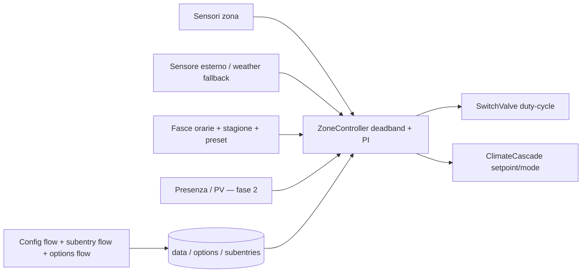

# Plan: Climate Governor — integrazione meteo/zonale per Home Assistant

**Contesto verificato:** HA **2026.10.4** su Python 3.14 (`probatio` sostituisce `voluptuous`), subentries pienamente supportati (`ConfigSubentryFlow`, `async_get_supported_subentry_types`, `async_add_entities(config_subentry_id=...)`), `ConfigEntry[T]` + `runtime_data`, `ConditionSelector` + valutazione runtime con `condition.async_conditions_from_config`. Nota importante: `generic_thermostat` è **congelato** upstream — ottimo motivo per questa integrazione.

**TL;DR** — Un solo config entry (l'impianto) con **subentries per zona e per fascia oraria**. Il loop di controllo è **ibrido: deadband + duty-cycle PI** (niente PID classico, le masse termiche a acqua hanno dead-time troppo lungo), con bias da compensazione meteo. Ogni attuatore viene **sondato per capacità** all'avvio, così regge i casi che hai indicato: climate senza target temperature, inverter con modalità dry ma senza target humidity. UI di sistema nei flow (config/subentry/options), UI utente tramite entità `number`/`select`/`switch` con `EntityCategory.CONFIG` + dashboard YAML pronta (zero build JS).



## Environment facts (verified)

- HA **2026.10.4**, Python **3.14**, venv `/workspace/.venv` (uv). `probatio` 0.13.0 replaces voluptuous (`homeassistant/__init__.py` calls `install_as_voluptuous()`, so `import voluptuous as vol` still works).
- Subentries fully available: `ConfigSubentryFlow` (config_entries.py:3882), `ConfigFlow.async_get_supported_subentry_types` (:3194), `ConfigEntry.get_subentries_of_type` (:664), `async_add_entities(..., config_subentry_id=...)` (entity_platform.py:147), `MockConfigEntry(subentries_data=...)` + `start_subentry_reconfigure_flow` (phcc common.py:1125/1212).
- Options flows: `OptionsFlow` (:4135), `OptionsFlowWithReload` (:4209). `OptionsFlowWithConfigEntry` deprecated.
- `ConfigEntry[T]` generic alias + `entry.runtime_data` (pattern: `components/forecast_solar/coordinator.py:31`).
- `DataUpdateCoordinator(config_entry=...)` — **no** `ConfigEntryDataUpdateCoordinator` in this version.
- `ConditionSelector` (selector.py:749) validates `cv.CONDITIONS_SCHEMA`; runtime eval via `condition.async_validate_conditions_config` (:2231) + `async_conditions_from_config` (:2240) → `ConditionsChecker`.
- `data_entry_flow.section` supports only `collapsed` — **no `visible=` in 2026.10.4**; `show_advanced_options` deprecated.
- `EntityCategory.CONFIG` / `DIAGNOSTIC` (const.py:1026).
- `generic_thermostat` is **FROZEN** upstream (its const.py header says so) → good reason for this integration; reuse its timer/cycle patterns (climate.py:568-780).
- Platform enum = `homeassistant.generated.entity_platforms.EntityPlatforms` (CLIMATE, NUMBER, SELECT, SWITCH, SENSOR, BINARY_SENSOR, BUTTON). No TRIGGER/CONDITION/ACTION platform for custom integrations.
- `manifest` keys live in `loader.py:246` (`single_config_entry`, `integration_type`, `dependencies`).
- diagnostics: `async_get_config_entry_diagnostics`; repairs: `ir.async_create_issue` / `ir.async_refresh_issues`.
- weather forecast from another integration: call service `weather.get_forecasts` (type hourly/daily).

## Decisions from the user

1. Actuators: native `climate.*` (cascade) **and** `switch.*` motorized valves; must be testable with fake entities.
2. Control law: **hybrid deadband + duty-cycle PI** (no classic PID for slow hydronic masses).
3. Scheduling: **internal to the integration**, stored in config entry, exposed as entities.
4. Lovelace: **standard entities + shipped YAML dashboard** (no JS build in v1).
5. Config model: **one config entry + subentries per zone / schedule period**.
6. PV: power sensors + production forecast; presence: `person.*`.
7. v1 scope: zone thermoregulation (heat+cool) + config UI + weekly schedule + seasonal presets + tests + diagnostics. Humidity/dehumidification interlock and PV/presence: **designed now, implemented in phase 2**.
8. Capability handling (explicit user requirement): the integration must tolerate actuators that **lack TARGET_TEMPERATURE**, and climate actuators that have **DRY mode but no TARGET_HUMIDITY**. → capability-driven actuator adapter, probed at setup.
9. Guards/interlocks: HA **ConditionSelector** (user-composed conditions).

## Architecture

Layers:
- `control.py` / `schedule.py` — **pure python, no HA imports** → fast deterministic unit tests.
- `actuators.py` — capability-probing adapters (switch valve, climate cascade).
- `coordinator.py` — one `DataUpdateCoordinator` per entry; owns zone controllers, timers, sensor aggregation.
- platform files — thin entity wrappers reading coordinator state.

## Target file layout

```
custom_components/climate_governor/
  manifest.json      # + single_config_entry, integration_type: helper, after_dependencies
  const.py           # DOMAIN, CONF_* keys, defaults, SUBENTRY_TYPE_ZONE/PERIOD, PLATFORMS
  models.py          # frozen dataclasses: ZoneSpec, ActuatorSpec, SensorSpec, ControlParams, PeriodSpec
  config_flow.py     # ConfigFlow + OptionsFlow + ZoneSubentryFlow + PeriodSubentryFlow
  __init__.py        # async_setup_entry, runtime_data, update listener, migrations, repairs check
  coordinator.py     # ClimateGovernorConfigEntry alias + GovernorCoordinator
  control.py         # pure control law
  schedule.py        # pure schedule resolution
  actuators.py       # ActuatorAdapter, SwitchValveActuator, ClimateCascadeActuator
  sensors.py         # multi-sensor aggregation + outdoor source (sensor|weather)
  climate.py         # GovernorClimateEntity (one per zone subentry)
  number.py select.py switch.py sensor.py binary_sensor.py button.py
  diagnostics.py repairs.py strings.json icons.json services.yaml
tests/
  conftest.py const.py fixtures.py
  test_control.py test_schedule.py test_config_flow.py test_subentries.py
  test_actuator_switch.py test_actuator_climate.py test_climate_entity.py
  test_diagnostics.py test_repairs.py
  snapshots/
```

## Control law (v1)

Heating error `e = T_set_eff - T_meas`; cooling `e = T_meas - T_set_eff`.

- Deadband: `|e| <= tolerance` → `e = 0` (hysteresis on exit from band, ±tolerance).
- PI with anti-windup: `u = clip(Kp*e + Ki*I + b_reset + b_pv, 0, 100)`; `I += e*dt` only when not saturated and actuator not blocked; `I *= exp(-dt/tau_i)` decay when idle.
- Duty-cycle for switch valves, window `W` (default 900 s): `t_on = clip(u/100 * W, t_on_min, W - t_off_min)`; scheduled with `async_call_later` (mirrors generic_thermostat `_async_heater_turn_on/_async_control_heating` timers, incl. `cycle_cooldown` and context-based attribution of our own switch changes).
- Outdoor reset bias: `b_reset = clip(k_or * (T_design_out - T_out), 0, b_max)` (heating), inverted for cooling.
- Cascade (inverter climate actuators): **no PWM** — `u` only shifts the setpoint by `offset = clip(u/100 * max_offset, 0, max_offset)` and selects HVAC mode; respects probed `min_temp/max_temp/target_temp_step/hvac_modes`.
- Season scales `Kp/Ki`, `tolerance`, `max_offset` and the outdoor-reset slope.

## Capability normalization (user requirement #8)

At setup each actuator is probed from its state attributes: `hvac_modes`, `supported_features`, `min_temp`, `max_temp`, `target_temp_step`, `min_humidity`, `max_humidity`, `target_humidity_step`, `preset_modes`, `fan_modes`.

Adapter behaviour matrix:

| Actuator capability | Governor behaviour |
|---|---|
| `switch.*` valve | duty-cycle PI on/off (primary hydronic path) |
| `climate.*` with TARGET_TEMPERATURE | setpoint push + mode selection |
| `climate.*` **without** TARGET_TEMPERATURE | mode-only control (`hvac_mode` + `turn_on/turn_off`); zone setpoint stays internal; governor exposes its own target |
| `climate.*` with DRY but **no** TARGET_HUMIDITY (phase 2) | humidity band → dry mode on/off, never call `climate.set_humidity` |
| capability changes at runtime | re-probe on `EVENT_STATE_REPORTED`/attributes change + repair issue on mismatch |

Probed capabilities are surfaced as `sensor.<zone>_actuator_capabilities` (diagnostic) and drive `supported_features` of the governor's own climate entity.

## Config model

- **System config** (config flow / subentry flows / reconfigure):
  - `entry.data`: name, unique_id, outdoor source (`sensor.*` or `weather.*` + fallback chain), global actuator/sensor defaults.
  - subentry `zone`: name, area/floor selector, temperature sensors (multi + aggregation), humidity sensor (phase 2), actuators list (role heat/cool/dehumidify + entity_id + kind), control overrides, interlock conditions (phase 2, `ConditionSelector`).
  - subentry `period`: zones selector, weekday set, `from`/`to` time, target preset.
- **User config** (options flow + `EntityCategory.CONFIG` entities + Lovelace): presets setpoints, season select, tolerances, Kp/Ki, cycle window, per-zone enable/boost switches, setpoint offsets, feature toggles.
- Reload strategy: plain `OptionsFlow` + `entry.add_update_listener(...)` → `async_schedule_reload` (do **not** use `OptionsFlowWithReload` together with update listeners).

## Steps

### Phase A — foundations (parallel-safe)
1. `const.py`: DOMAIN, all `CONF_*` keys, defaults, `SUBENTRY_TYPE_ZONE`, `SUBENTRY_TYPE_PERIOD`, `PLATFORMS = [CLIMATE, NUMBER, SELECT, SWITCH, SENSOR, BINARY_SENSOR, BUTTON]`.
2. `models.py`: frozen dataclasses + `from_subentry()` parsers; `ControlParams` with season multipliers.
3. `control.py`: pure `StepResult compute(error, dt, params, state) -> ControlState` + deadband, anti-windup, duty-window, outdoor-reset helpers. No HA imports.
4. `schedule.py`: pure `resolve(now, periods, presets, season) -> (preset, setpoint, next_change)`.
5. `manifest.json`: add `single_config_entry: true`, `integration_type: "helper"`, `after_dependencies: ["weather", "person"]`, real `documentation`/`issue_tracker`.

### Phase B — config UI (depends on A1-A2)
6. `config_flow.py`: `async_step_user` (name + unique_id via `ulid`/slug, outdoor source) → `async_create_entry(..., subentries=[first zone])`; `async_step_reconfigure`; `async_get_options_flow` → `GovernorOptionsFlow(OptionsFlow)` (menu: presets / control defaults / season / features); `async_get_supported_subentry_types` → `ZoneSubentryFlow`, `PeriodSubentryFlow` (each with `user` + `reconfigure`, using `probatio` + selectors, `data_entry_flow.section(collapsed=True)` for advanced tuning).
7. `strings.json` full `config`, `config_subentries.{zone,period}`, `options`, `issues`, `entity` sections; `icons.json` for sections/entities.
8. `__init__.py`: typed `ClimateGovernorConfigEntry = ConfigEntry[GovernorData]`, `runtime_data`, `entry.async_on_unload(entry.add_update_listener(...))`, `async_migrate_entry` (v1 empty-data entry → v2), `CONFIG_SCHEMA = cv.config_entry_only_config_schema(DOMAIN)`.

### Phase C — actuator + sensor layer (depends on A)
9. `actuators.py`: `ActuatorAdapter` base (probe capabilities, `async_apply(setpoint/mode/on_off)`, cycle timers, own-context detection like generic_thermostat `_last_context_id`); `SwitchValveActuator` (duty-cycle window, min/max on, cooldown); `ClimateCascadeActuator` (mode + setpoint, capability fallbacks).
10. `sensors.py`: multi-sensor aggregation (mean/median/min/max, stale handling), outdoor source chain `sensor.* → weather.* current → weather.get_forecasts` with repair issue when all fail.

### Phase D — coordinator + entities (depends on B, C)
11. `coordinator.py`: `GovernorCoordinator(DataUpdateCoordinator[GovernorState])` owning per-zone `ZoneController` (control + schedule + actuators), `async_track_time_interval` tick, `async_track_state_change_event` on sensors/actuators, `async_call_later` duty scheduling.
12. `climate.py`: `GovernorClimateEntity(ClimateEntity, RestoreEntity)` per zone subentry, `config_subentry_id=subentry.subentry_id`; `hvac_modes`/`supported_features` derived from adapters; `async_set_temperature/hvac_mode/preset_mode` write to controller + restore state.
13. `number.py` (Kp, Ki, tolerance, cycle window, setpoint offset — `EntityCategory.CONFIG`), `select.py` (schedule assignment, season), `switch.py` (zone enable, boost, master heat/cool), `sensor.py` (duty %, control output, integral, next schedule change, capabilities — DIAGNOSTIC), `binary_sensor.py` (actuator active, blocked, in-comfort), `button.py` (reset integral).
14. `services.yaml` + entity services registered through `EntityPlatform.async_register_entity_service` (e.g. `climate_governor.reset_integral`, `climate_governor.set_hold`).

### Phase E — diagnostics, repairs, tests (depends on D)
15. `diagnostics.py` (`async_get_config_entry_diagnostics`, redact entity ids not needed but keep structure), `repairs.py` fix flows for `no_outdoor_source`, `actuator_capability_mismatch`, `zone_no_actuator`.
16. Tests: pure `test_control.py` (deadband, anti-windup, duty clamps, outdoor reset), `test_schedule.py` (weekday/DST/midnight-crossing periods), `test_config_flow.py` (rewrite existing test — it currently asserts an empty-data entry), `test_subentries.py` (add/reconfigure zone + period), `test_actuator_switch.py` (frozen time + `async_fire_time_changed` duty-cycle assertions), `test_actuator_climate.py` (capability fallbacks incl. no-TARGET_TEMPERATURE and DRY-without-humidity), `test_climate_entity.py`, `test_diagnostics.py` (syrupy snapshot).
17. Dev fixtures: `configuration.yaml` gains `input_number`/`switch`/`template` fake sensors, or `tests/fixtures.py` helpers, so the UI can be exercised end-to-end.

### Phase F — Lovelace (depends on D)
18. `dashboard/climate-governor.yaml` (repo-level, not inside the integration) + README instructions: sections view with `type: thermostat` cards per zone, `entities` cards for tuning numbers (`entity_category: config` cards are hidden by default → show via `type: entities`), `gauge` for duty cycle, `history-graph` for temp vs target.
19. README: system-vs-user config split, dashboard install (storage dashboard or `lovelace.dashboards:` YAML), and a "no custom card required" note.

### Phase G — design-only for v2 (documented, not implemented)
20. Humidity/dehumidification: `TARGET_HUMIDITY` band control, DRY-mode adapter with the no-target-humidity fallback, `interlock.py` evaluating `ConditionSelector` conditions through `condition.async_conditions_from_config` (window/port/presence), `presence.py` (person/zone → auto-away master switch), `pv.py` (surplus power sensor + `weather.get_forecasts`/Solcast-style forecast → `b_pv` bias and pre-heating lead time). Data model fields and entity slots reserved now.

## Relevant files

- `custom_components/climate_governor/config_flow.py` — replace single empty step with menu-driven multi-step flow + `async_get_supported_subentry_types` + `OptionsFlow`; reference `.venv/.../homeassistant/components/forecast_solar/config_flow.py` (subentry + options + reconfigure pattern).
- `custom_components/climate_governor/__init__.py` — add `runtime_data`, update listener, migration; reference `components/forecast_solar/__init__.py:86-118`.
- `custom_components/climate_governor/climate.py` — add `GovernorClimateEntity`; reference `components/generic_thermostat/climate.py:568-780` for cycle timers and `_async_switch_changed`.
- `custom_components/climate_governor/const.py` — expand constants; reference `components/generic_thermostat/const.py`.
- `custom_components/climate_governor/manifest.json` — `single_config_entry`, `integration_type`, `after_dependencies`.
- `custom_components/climate_governor/strings.json` — `config`, `config_subentries`, `options`, `issues`, `entity`.
- `tests/test_config_flow.py` — must be rewritten (current assertions break with the new flow).
- `configuration.yaml` — dev fixtures for fake sensors/switches.

## Verification

1. `pytest -q` in the container (all suites green; `test_control.py`/`test_schedule.py` run without HA harness).
2. `ruff check .` clean (rules E, F, I, UP; target py314).
3. Task **Run Home Assistant** → http://localhost:8123: add integration → create zone subentry (pick fake `sensor.*` temperature + `switch.*` valve) → add period subentry (Mon-Fri 06:30-08:30 → comfort) → verify device + entities appear, `climate.*` card responds to preset/hvac mode, `sensor.*_duty_cycle` moves.
4. Force a duty cycle: set fake temp 1 °C below target, watch `switch.valve` turn on for `u/100 * W` and off again (log `custom_components.climate_governor: debug` already enabled).
5. Capability fallback: create a fake `climate.*` with `hvac_modes` only (no target_temperature support) and confirm the governor never calls `climate.set_temperature` (assert via `hass.async_block_till_done` + service call spy in `test_actuator_climate.py`).
6. Subentry delete → its entities disappear (because added with `config_subentry_id`).
7. Options change → entry reloads, no orphan entities, no duplicate repair issues.
8. Diagnostics download from the config entry page → snapshot test matches.
9. Dashboard YAML loads and shows per-zone thermostat cards + tuning entities.

## Further considerations

1. **Period subentries vs one schedule subentry** — recommendation: one subentry per time period (days + from/to + preset). Maps 1:1 to HA's subentry UI (add/edit/remove each period), avoids nested-list forms which the frontend cannot render. Alternative A: single `schedule` subentry with a JSON `ObjectSelector` blob (fast to build, poor UX). Alternative B: `select`/`number`/`time` entities per slot (many entities, but fully Lovelace-editable).
2. **Where the governor's own climate lives** — recommendation: one `climate.<zone>` virtual entity per zone subentry (single card per room, works with the built-in thermostat card and Climate dashboard). Alternative: expose only numbers/switches and no climate entity (loses native UI).
3. **Custom card later** — if a compact multi-zone UI is wanted, add a `custom:climate-governor-card` (Lit, dashboard resource) in a separate repo/`www/` folder; the entity model already supports it, and `websocket_api.async_register_command` is available if live controller internals must be shown.
